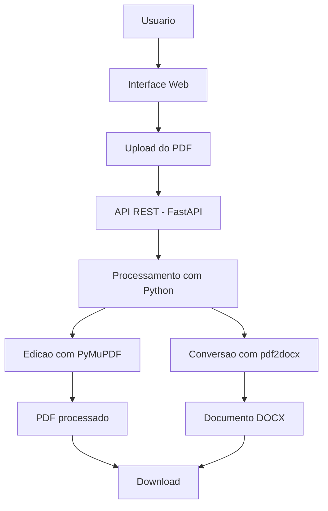

# PDF Tools — Edição e Conversão de Documentos

Aplicação web desenvolvida em Python e FastAPI para edição, conversão e processamento de documentos PDF.

A solução disponibiliza ferramentas para edição de campos em documentos, personalização de textos e conversão de arquivos PDF para Word, utilizando uma arquitetura modular com separação entre frontend e backend e comunicação por APIs REST.

## Contexto e objetivo

O projeto foi desenvolvido para centralizar ferramentas de manipulação de documentos PDF em uma única aplicação web, simplificando atividades de edição e conversão de arquivos.

A solução busca automatizar operações de processamento documental, permitindo a execução dessas atividades diretamente por meio de uma interface web.

## Funcionalidades

- Upload de documentos PDF.
- Edição de campos em documentos.
- Personalização de textos e estilos.
- Formatação em negrito, itálico e sublinhado.
- Personalização de cores dos textos.
- Processamento de documentos com PyMuPDF.
- Conversão de arquivos PDF para Word (.docx).
- Modos de conversão por layout ou texto.
- Seleção de páginas para conversão.
- Suporte a documentos protegidos por senha.
- Download dos documentos processados.
- Comunicação entre frontend e backend por APIs REST.
- Feedback visual durante o processamento.
- Configuração de limites de upload.
- Suporte à execução em containers Docker.

## Interface da aplicação

### Página inicial


### Editor de documentos PDF


### Conversão de PDF para Word


## Módulos da aplicação

| Módulo | Descrição | Situação |
|---|---|---|
| Edição de PDF | Inserção, edição e formatação de campos em documentos PDF. | Implementado |
| PDF para Word | Conversão de documentos PDF para arquivos DOCX. | Implementado |
| PDF para Excel | Conversão de informações de documentos PDF para planilhas XLSX. | Em desenvolvimento |
| OCR PDF | Reconhecimento de texto e geração de documentos PDF pesquisáveis. | Em desenvolvimento |

## Arquitetura da aplicação

O projeto utiliza uma estrutura modular, separando os componentes de interface, comunicação e processamento de documentos.



## Endpoints da API

| Método | Endpoint | Finalidade |
|---|---|---|
| POST | `/api/apply` | Aplicação de campos e geração do PDF editado. |
| POST | `/api/convert/word` | Conversão de documentos PDF para Word. |

A aplicação utiliza FastAPI para gerenciamento das rotas e processamento das requisições.

## Tecnologias utilizadas

| Tecnologia | Finalidade |
|---|---|
| Python | Desenvolvimento e processamento de documentos |
| FastAPI | Desenvolvimento de APIs REST |
| Starlette | Componentes e recursos do framework web |
| PyMuPDF | Manipulação e processamento de documentos PDF |
| pdf2docx | Conversão de arquivos PDF para Word |
| python-docx | Manipulação de documentos DOCX |
| HTML | Estruturação da interface |
| CSS | Estilização dos componentes |
| JavaScript | Interatividade e comunicação com a API |
| Uvicorn | Servidor ASGI |
| Docker | Containerização da aplicação |
| Docker Compose | Configuração e execução do ambiente |
| Git | Controle de versão |
| GitHub | Versionamento e documentação |

## Estrutura do projeto

```text
.
├── app.py
├── requirements.txt
├── Dockerfile
├── docker-compose.yaml
├── CHANGELOG.md
├── estrutura.txt
├── assets/
│   └── print/
│       ├── print1.png
│       ├── print2.png
│       ├── print3.png
│       ├── print4.png
│       ├── print5.png
│       └── print6.png
├── backend/
│   ├── __init__.py
│   ├── api_apply.py
│   └── api_convert_word.py
└── frontend/
    ├── __init__.py
    ├── converter_word.py
    ├── converter_excel.py
    ├── layout_campo.py
    ├── layout_inicial.py
    ├── ocr.py
    ├── ui_css.py
    └── ui_js.py
```

## Como utilizar

### Edição de PDF

1. Acesse o módulo de edição de documentos.
2. Realize o upload do arquivo PDF.
3. Configure os campos e estilos desejados.
4. Aplique as alterações ao documento.
5. Realize o download do PDF processado.

### Conversão de PDF para Word

1. Acesse o módulo de conversão.
2. Realize o upload do arquivo PDF.
3. Selecione o modo e as opções de conversão.
4. Execute o processamento.
5. Realize o download do documento DOCX.

## Como executar

### Requisitos

- Python 3.9 ou superior.
- Dependências disponíveis no arquivo `requirements.txt`.
- Docker e Docker Compose (opcional).
- Tesseract OCR e Ghostscript para recursos opcionais de OCR.

### 1. Clonar o repositório

```bash
git clone https://github.com/paesdj1987/pdf-tools.git
cd pdf-tools
```

### 2. Criar um ambiente virtual

```bash
python -m venv .venv
```

Ativação no Windows:

```bash
.venv\Scripts\activate
```

Ativação no Linux/macOS:

```bash
source .venv/bin/activate
```

### 3. Instalar as dependências

```bash
pip install -r requirements.txt
```

### 4. Executar a aplicação

```bash
uvicorn app:app --reload --host 0.0.0.0 --port 8055
```

Acesse a aplicação pelo navegador:

http://127.0.0.1:8055

### Documentação da API

Quando habilitada, a documentação interativa da API pode ser acessada pelos seguintes endereços:

- Swagger UI: http://127.0.0.1:8055/docs
- ReDoc: http://127.0.0.1:8055/redoc

## Executar com Docker

Como alternativa à instalação local, o projeto disponibiliza arquivos de configuração para execução em containers.

### Docker

Construir a imagem:

```bash
docker build -t pdf-tools .
```

Executar o container:

```bash
docker run -p 8055:8055 pdf-tools
```

### Docker Compose

Construir e iniciar o ambiente:

```bash
docker compose up --build
```

Encerrar o ambiente:

```bash
docker compose down
```

## Configurações

A aplicação disponibiliza variáveis de ambiente para personalização das configurações de execução.

| Variável | Descrição | Valor padrão informado |
|---|---|---|
| `MAX_UPLOAD_MB` | Limite máximo de upload em megabytes. | 50 |
| `DISABLE_DOCS` | Desabilita a documentação da API quando configurada como `1`. | — |
| `TRUSTED_HOSTS` | Lista de hosts confiáveis, separados por vírgula. | — |
| `ALLOWED_ORIGINS` | Origens permitidas nas configurações de CORS. | — |

Para utilização dos recursos opcionais de OCR, o Tesseract e o Ghostscript devem estar instalados e disponíveis no PATH do sistema.

## Competências aplicadas

- Processamento e manipulação de documentos.
- Automação de processos.
- Conversão entre formatos de arquivos.
- Processamento de dados não estruturados.
- Desenvolvimento de APIs REST.
- Desenvolvimento frontend e backend.
- Arquitetura modular de aplicações.
- Integração entre componentes de software.
- Configuração de aplicações web.
- Containerização com Docker.
- Versionamento de código.

## Observações

A qualidade da conversão dos documentos pode variar de acordo com a estrutura, a formatação e as características do arquivo PDF original.

Os módulos de conversão para Excel e reconhecimento de texto para geração de PDFs pesquisáveis encontram-se em desenvolvimento.

## Autor

**João Paes**

- [GitHub](https://github.com/paesdj1987)
- [LinkedIn](https://www.linkedin.com/in/joao-paes87)
- [Portfólio](https://joao-paes.vercel.app/)

