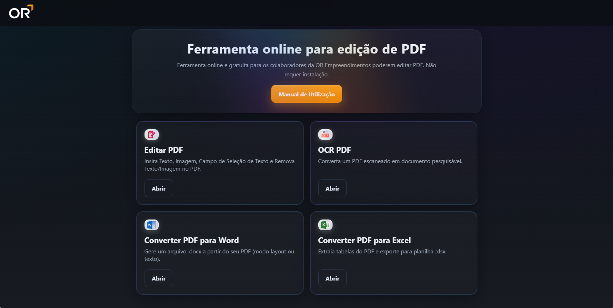
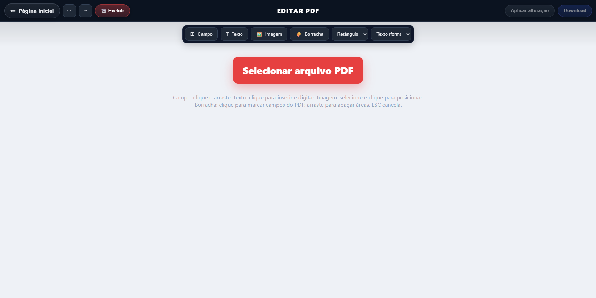
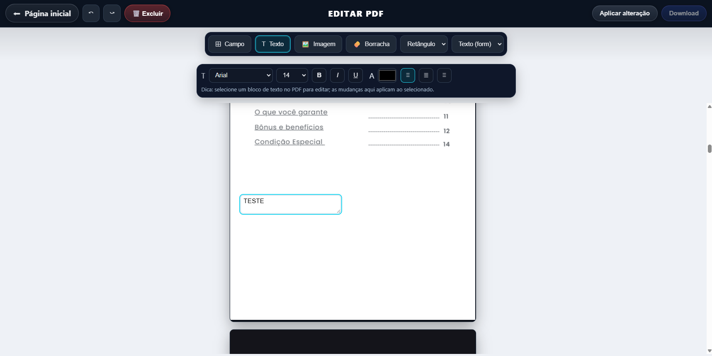
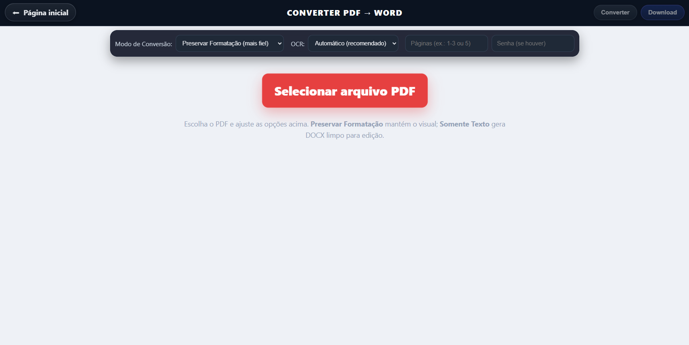
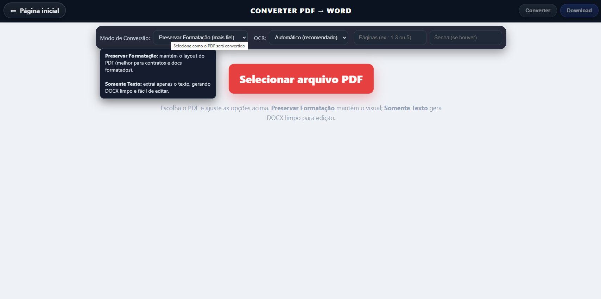
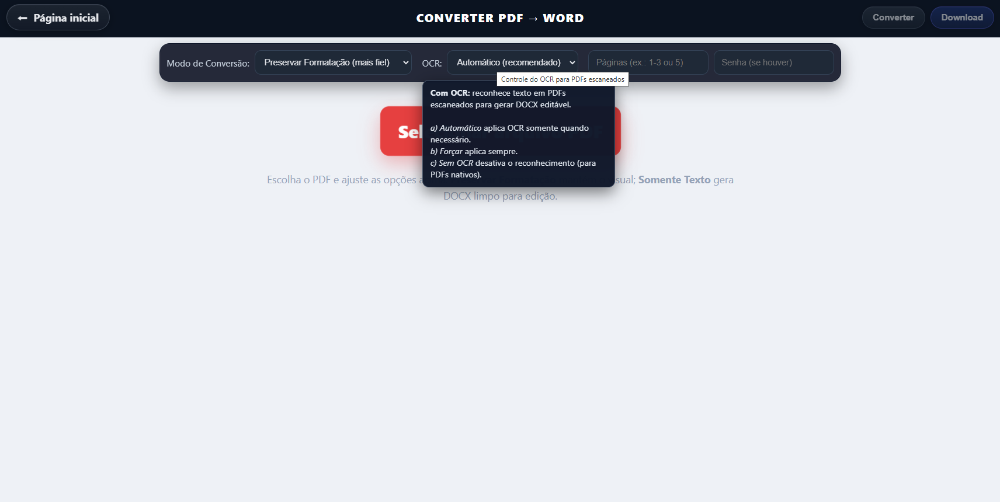

# 📝 edit_pdf – Aplicação FastAPI para Edição e Conversão de PDFs

## 📝 Descrição

**editar_pdf** é uma aplicação web construída com **Python** e **FastAPI** para editar PDFs e converter arquivos PDF para **Word (.docx)**. O app organiza rotas de frontend e backend, com páginas estilizadas, upload simples e feedback visual (toasts). Os módulos de conversão em documento pesquisável **OCR PDF** e converção de PDF em **Excel (.xlsx)** estão em construção.

---

## 📷 Capturas de Tela








---

## ⚙️ Tecnologias Utilizadas

- **Python**
- **FastAPI** (Starlette)
- **PyMuPDF (fitz)**
- **pdf2docx** e **python-docx**
- **Uvicorn**
- **Docker/Docker Compose** (opcional)

---

## 🛠️ Requisitos

- Python 3.9+ instalado
- Ambiente virtual recomendado
- Dependências listadas em `requirements.txt`

Opcional:
- Tesseract OCR e Ghostscript no PATH (quando usar OCR)
- Docker e Docker Compose instalados

---

## 🚀 Instalação (Local)

1) Clone o repositório:

```bash
git clone <URL_DO_REPOSITORIO>
cd editar_pdf
```

2) Crie e ative o ambiente virtual:

- Windows:
  ```bash
  python -m venv venv
  venv\Scripts\activate
  ```
- Linux/Mac:
  ```bash
  python -m venv venv
  source venv/bin/activate
  ```

3) Instale as dependências:

```bash
pip install -r requirements.txt
```

4) Execute a aplicação:

```bash
uvicorn app:app --reload --host 0.0.0.0 --port 8055
```

A aplicação inicia em `http://127.0.0.1:8055`.

---

## 🐳 Executar com Docker (Opcional)

Build e run com Docker:

```bash
docker build -t editar_pdf .
docker run -p 8055:8055 editar_pdf
```

Ou usando Docker Compose:

```bash
docker-compose up --build
```

Parar e remover:

```bash
docker-compose down
```

---

## 🧭 Estrutura do Projeto

```text
editar_pdf/
├── app.py                        # Ponto de entrada FastAPI (routers e assets)
├── requirements.txt              # Dependências
├── Dockerfile                    # Build da imagem Docker
├── docker-compose.yaml           # Orquestração local com Compose
├── CHANGELOG.md                  # Histórico de alterações
├── estrutura.txt                 # Notas/estrutura auxiliares
├── assets/                       # Arquivos estáticos servidos em /assets
├── backend/
│   ├── __init__.py               # Agrega routers do backend
│   └── api_convert_word.py       # Endpoint /api/convert/word (PDF → DOCX, OCR opcional)
└── frontend/
    ├── __init__.py               # Router do frontend
    ├── converter_word.py         # Página Converter PDF → Word
    └── ui_css.py                 # Estilos compartilhados
```

---

## 🗺️ Páginas e Funcionalidades

- Converter PDF → Word: upload, modo (Layout/Text), OCR opcional, páginas e senha.
- Feedback visual: status, toasts e botão “Converter” com loading e spinner.
- Download do arquivo `.docx` gerado.
- Servir assets estáticos via `/assets`.

---

## 🔧 Configuração

- Variáveis de ambiente:
  - `MAX_UPLOAD_MB`: limite de upload (MB). Default: 50.
  - `DISABLE_DOCS`: desativa docs (`/docs`, `/redoc`). `1` para desabilitar.
  - `TRUSTED_HOSTS`: hosts confiáveis (separados por vírgula).
  - `ALLOWED_ORIGINS`: CORS (separados por vírgula).
- OCR (opcional): instale Tesseract e Ghostscript e garanta-os no PATH.

---

## 👤 Autor

Desenvolvido por João Danilo

